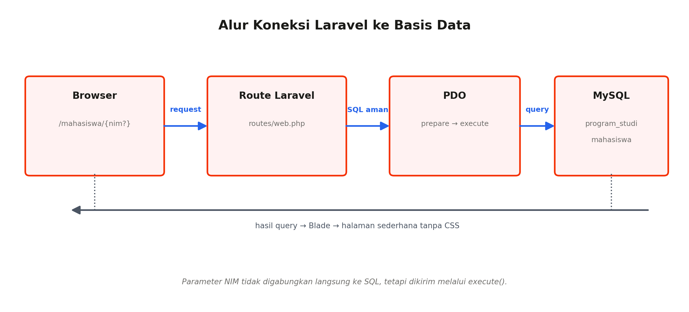

# Praktikum Pemrograman Web (INF11197)

Repository ini berisi hasil praktikum **Pemrograman Web** menggunakan framework **Laravel**, dikerjakan bertahap per pertemuan pada satu proyek yang sama.

## Identitas

| | |
|---|---|
| Nama | Raihan Darma Putra |
| NIM | 2401020138 |
| Program Studi | Teknik Informatika |
| Mata Kuliah | Praktikum Pemrograman Web (INF11197), Semester V |
| Institusi | Fakultas Teknik dan Teknologi Kemaritiman, Universitas Maritim Raja Ali Haji |
| Dosen | Berta Erwin Slam, S.T., M.Kom.; Muhamad Radzi Rathomi, S.Kom., M.Cs.; Nolan Efranda, M.Kom. |

## Teknologi

- PHP 8.2 atau lebih baru
- Laravel 12
- MySQL / MariaDB (diakses melalui PDO)
- Blade (HTML polos tanpa CSS)
- Composer, Node.js, Git
- Laragon sebagai lingkungan pengembangan lokal

## Daftar Pertemuan

| Pertemuan | Topik | Hasil | Alamat uji |
|---|---|---|---|
| 1 | Lingkungan pengembangan web dan Laravel | Proyek Laravel bawaan, repository Git awal | `/` |
| 2 | Sintaks dasar PHP pada proyek Laravel | Variabel, operator, percabangan, perulangan, dan fungsi | `/latihan-php` |
| 3 | Form, request, sanitasi, dan validasi | Form mahasiswa dengan validasi server-side | `/form-mahasiswa` |
| 4 | Perancangan basis data dan SQL dasar | Skema `program_studi` dan `mahasiswa`, DDL, DML | file SQL di `database/sql/` |
| 5 | Koneksi Laravel ke basis data dengan PDO | Prepared statement dan penanganan error | `/mahasiswa` dan `/mahasiswa/{nim}` |

## Diagram

### Pertemuan 1: Alur client-server dan HTTP


### Pertemuan 3: Alur GET, POST, sanitasi, dan validasi


### Pertemuan 4: Skema relasi data mahasiswa


### Pertemuan 5: Alur koneksi Laravel ke basis data


## Struktur yang Relevan

```text
.
├── database/
│   └── sql/
│       ├── pertemuan4_struktur.sql   # DDL: database dan tabel
│       └── pertemuan4_data.sql       # DML: data latihan
├── images/                           # diagram untuk laporan
├── resources/views/
│   ├── latihan-php.blade.php         # Pertemuan 2
│   ├── form-mahasiswa.blade.php      # Pertemuan 3
│   ├── hasil-form.blade.php          # Pertemuan 3
│   └── mahasiswa.blade.php           # Pertemuan 5
├── routes/web.php                    # seluruh route praktikum
└── .env.example                      # contoh konfigurasi tanpa kata sandi
```

## Cara Menjalankan

### 1. Persiapan

Pastikan PHP, Composer, dan MySQL/MariaDB sudah terpasang, lalu aktifkan layanan MySQL (misalnya lewat Laragon).

### 2. Clone dan pasang dependensi

```bash
git clone https://github.com/Raihan2407/<nama-repository>.git
cd <nama-repository>
composer install
```

### 3. Atur file `.env`

```bash
copy .env.example .env
php artisan key:generate
```

Lalu sesuaikan isi `.env`:

```env
DB_CONNECTION=mysql
DB_HOST=127.0.0.1
DB_PORT=3306
DB_DATABASE=praktikum_web_2401020138
DB_USERNAME=root
DB_PASSWORD=

SESSION_DRIVER=file
```

> `SESSION_DRIVER=file` diperlukan karena basis data praktikum hanya berisi tabel `program_studi` dan `mahasiswa`. Dengan driver `database`, Laravel akan mencari tabel `sessions` yang tidak ada dan menampilkan error.

### 4. Siapkan basis data

Jalankan dari folder proyek:

```bash
mysql -u root -p
```

```sql
SOURCE database/sql/pertemuan4_struktur.sql;
SOURCE database/sql/pertemuan4_data.sql;
```

Jalankan masing-masing file **sekali saja**, dengan urutan struktur lalu data.

### 5. Jalankan aplikasi

```bash
php artisan config:clear
php artisan serve
```

Buka `http://127.0.0.1:8000`.

## Daftar Route

| Method | URL | Keterangan |
|---|---|---|
| GET | `/` | Halaman bawaan Laravel |
| GET | `/latihan-php` | Hitung rata-rata nilai dan status kelulusan |
| GET | `/form-mahasiswa` | Menampilkan form mahasiswa |
| POST | `/form-mahasiswa` | Sanitasi dan validasi input, lalu menampilkan hasil |
| GET | `/mahasiswa` | Menampilkan seluruh data mahasiswa dari basis data |
| GET | `/mahasiswa/{nim}` | Menampilkan satu mahasiswa berdasarkan NIM (prepared statement) |

Contoh pengujian Pertemuan 5:

- `/mahasiswa` menampilkan tiga data mahasiswa.
- `/mahasiswa/2401010002` hanya menampilkan satu data.
- `/mahasiswa/9999999999` menampilkan pesan "Data tidak ditemukan."
- Jika konfigurasi basis data salah, aplikasi menampilkan pesan error sederhana dengan status HTTP 500.

## Catatan Keamanan

- File `.env` **tidak** disertakan di repository karena dapat memuat kredensial. Gunakan `.env.example` sebagai acuan.
- Nilai NIM pada query tidak digabungkan langsung ke teks SQL, tetapi dikirim lewat `execute()` pada prepared statement PDO.
- Data pada file SQL adalah data latihan fiktif.

## Riwayat Commit

```text
Inisialisasi proyek Laravel
Pertemuan 2 latihan PHP dasar
Pertemuan 3 form dan validasi
Pertemuan 4 perancangan basis data
Pertemuan 5 koneksi PDO
Tambah folder images untuk diagram
```

## Referensi

- Slam, B. E., Rathomi, M. R., & Efranda, N. (2026). *Modul Praktikum Pemrograman Web Pertemuan 1 sampai 5*. Universitas Maritim Raja Ali Haji.
- [Laravel Documentation](https://laravel.com/docs)
- [PHP Manual](https://www.php.net/manual/en/)
- [MySQL Reference Manual](https://dev.mysql.com/doc/refman/8.4/en/)
- [Git Documentation](https://git-scm.com/doc)
